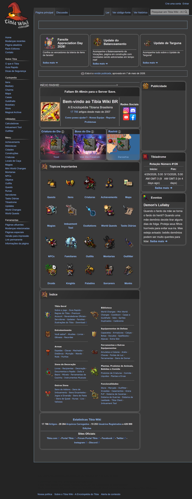
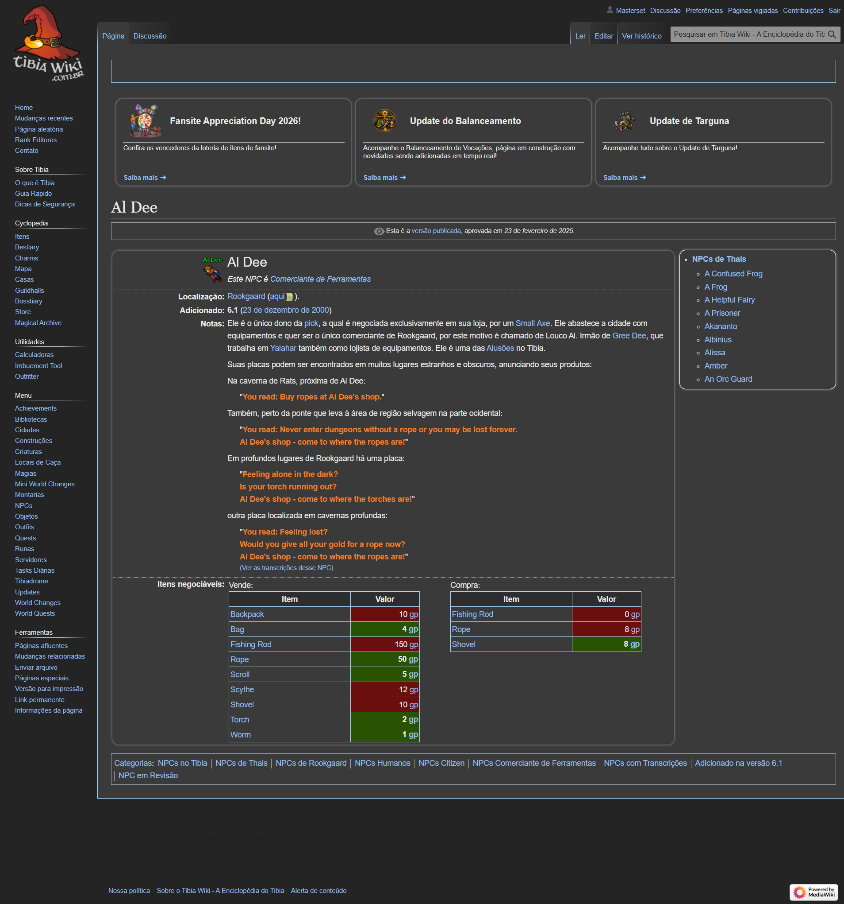
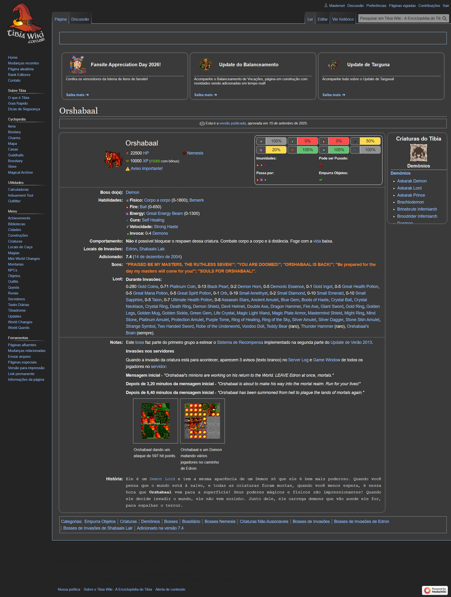
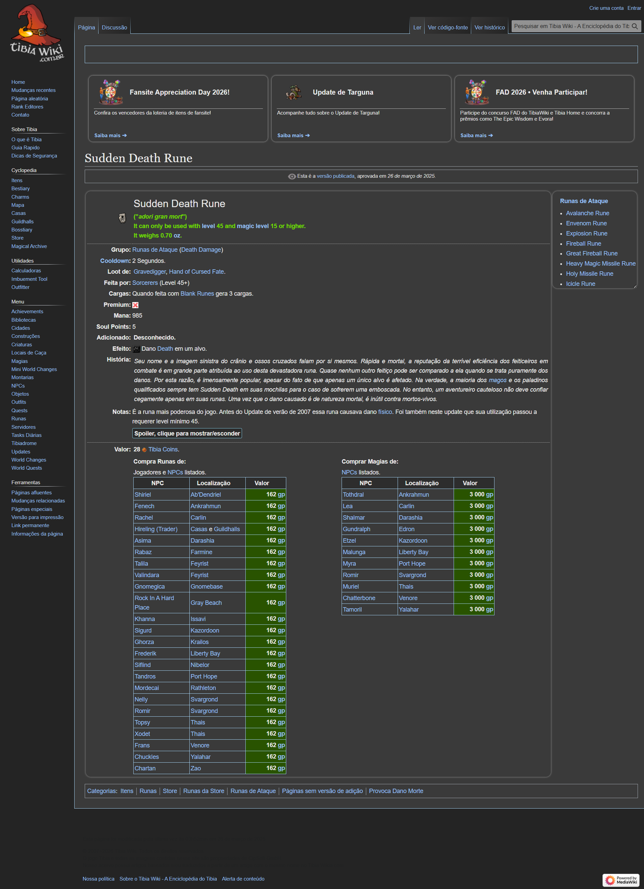
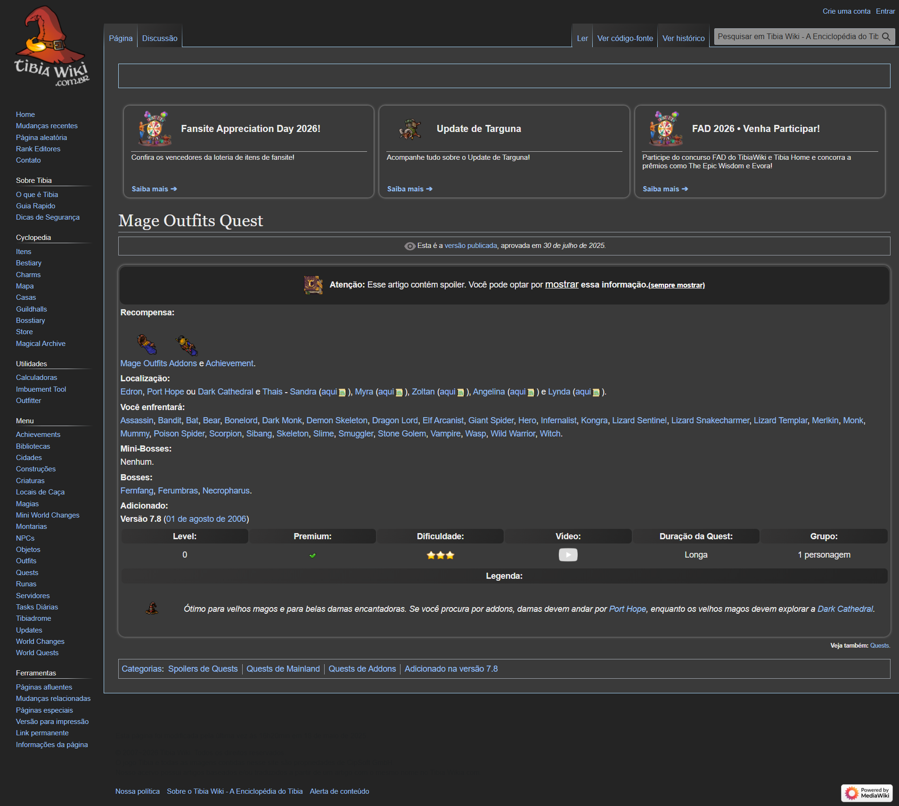

# Tibia Wiki Dark Mode

[](#)
[](LICENSE)


## Chrome Web Store

<a href="https://chrome.google.com/webstore/detail/tibia-wiki-dark-mode">

</a>

## Descrição

Extensão que ativa o modo escuro no Tibia Wiki, proporcionando melhor legibilidade e conforto visual durante longas sessões de navegação. Reduz a fadiga ocular com uma interface escura elegante, profissional e de alto contraste.

## Recursos

- 🌙 Modo escuro completo para [Tibia Wiki](https://www.tibiawiki.com.br/)
- 👁️ Reduz a fadiga ocular em ambientes de pouca luz
- ⚡ Injeção declarativa sem tela branca/flicker (`run_at: "document_start"`)
- 🎨 Design consistente organizado com CSS Custom Properties (Design Tokens)
- 🔍 Atalho na Omnibox: digite `tibiawiki` na barra de endereços para pesquisar diretamente
- 🚀 Totalmente compatível com Manifest V3

## Como Usar

### 🛠️ Instalação no Modo Desenvolvedor

Para utilizar a extensão localmente a partir do código-fonte no Google Chrome ou em qualquer navegador baseado em Chromium (Edge, Brave, Opera, Vivaldi):

1. **Obtenha o projeto**:
   ```bash
   git clone https://github.com/moraisandre/tibia-wiki-dark-mode.git
   ```
   *(Ou faça o download do ZIP pelo GitHub e extraia os arquivos em uma pasta).*

2. **Acesse a página de extensões**:
   - Digite `chrome://extensions/` na barra de endereços e pressione <kbd>Enter</kbd>.
   - Ou acesse pelo menu do navegador: **Menu** (três pontos) &rarr; **Extensões** &rarr; **Gerenciar extensões**.

3. **Ative o Modo do desenvolvedor**:
   - No canto superior direito da página, ative o botão seletor **"Modo do desenvolvedor"**.

4. **Carregue a extensão**:
   - Clique no botão **"Carregar sem compactação"** (ou *"Load unpacked"*) no canto superior esquerdo.
   - Selecione a pasta onde os arquivos do projeto estão localizados (a pasta que contém o `manifest.json`).

5. **Pronto para navegar**:
   - A extensão aparecerá na sua lista de extensões ativas.
   - Abra o [Tibia Wiki](https://www.tibiawiki.com.br/) e o tema escuro será aplicado automaticamente!

> [!TIP]
> **Testando alterações:** Se você modificar qualquer regra no `css/night-mode.css` ou no `js/background.js`, clique no ícone de **recarregar (🔄)** no card da extensão em `chrome://extensions/` e recarregue a página do Tibia Wiki (<kbd>F5</kbd>).

---

### 🚀 Atalhos e Recursos de Uso

- **Aplicação Instantânea**: O tema escuro é injetado no início do carregamento (`document_start`), sem piscar em branco.
- **Acesso Direto**: Clique no ícone do Tibia Wiki Dark Mode na barra de ferramentas do navegador para abrir a página inicial do Tibia Wiki.
- **Pesquisa Rápida pela Omnibox**:
  1. Selecione a barra de endereços do Chrome (<kbd>Ctrl</kbd> + <kbd>L</kbd> ou <kbd>F6</kbd>).
  2. Digite `tibiawiki` e pressione <kbd>Tab</kbd> ou <kbd>Espaço</kbd>.
  3. Digite o que procura (ex: `Demon Oak`, `Ferumbras`, `Mending`) e pressione <kbd>Enter</kbd>.

## Capturas de Tela

<picture>

</br>
<label>Tibia Wiki com modo escuro ativado</label>
</picture>
</br></br>

<picture>

</br>
<label>Página do NPC Al Dee com tema escuro</label>
</picture>
</br></br>

<picture>

</br>
<label>Navegação na página de criaturas dark mode</label>
</picture>

<picture>

</br>
<label>Exemplo de magias no dark mode</label>
</picture>

<picture>

</br>
<label>Página de outfit com a extensão ativa</label>
</picture>

## Requisitos

- Google Chrome versão 88 ou superior (ou qualquer navegador baseado em Chromium)
- Acesso ao site [tibiawiki.com.br](https://www.tibiawiki.com.br/)

## Desenvolvimento

### Estrutura do Projeto

```
├── manifest.json          # Configuração da extensão (Manifest V3)
├── css/
│   └── night-mode.css    # Estilos do modo escuro (tokens e seletores organizados)
├── js/
│   └── background.js     # Service Worker (pesquisa na omnibox e atalhos)
├── icons/                 # Ícones da extensão (16px, 48px, 128px)
└── images/                # Recursos visuais e capturas de tela
```

### Fluxo de Trabalho e Testes

1. Faça as modificações desejadas nos arquivos (`css/night-mode.css`, `js/background.js`, etc.).
2. Em `chrome://extensions/`, clique no botão **Recarregar** (ícone de seta circular) no card da extensão.
3. Atualize a página do [Tibia Wiki](https://www.tibiawiki.com.br/) com <kbd>F5</kbd> ou <kbd>Ctrl</kbd> + <kbd>F5</kbd> para inspecionar os novos estilos aplicados.

## Licença

Este projeto está licenciado sob a Licença MIT - veja o arquivo [LICENSE](LICENSE) para mais detalhes.

## Contribuições

Contribuições são bem-vindas! Sinta-se livre para abrir issues e pull requests.
